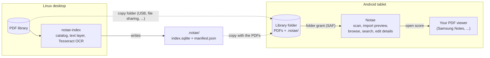

<div align="center">


**Index your sheet-music PDFs on a Linux desktop, then browse and search them
on an Android tablet. No cloud, no account, no network access.**

[](https://github.com/eRgo35/notae/actions/workflows/ci.yml)
[](https://github.com/eRgo35/notae/releases/latest)
[](LICENSE)
[](rust-toolchain.toml)
[](#install)

[Download](https://github.com/eRgo35/notae/releases/latest) ·
[Quick start](#quick-start) ·
[Documentation](#documentation) ·
[Changelog](CHANGELOG.md) ·
[Issues](https://github.com/eRgo35/notae/issues) ·
[Contributing](CONTRIBUTING.md)


<sub>Android emulator capture of a development build, with sample scores.</sub>

</div>

## Why Notae

If you keep a few hundred scanned or exported scores as plain PDFs, a file
manager gives you file names and nothing else; nothing can search the printed
text inside a scan. Notae adds a private catalogue on top of your existing
folder and leaves the PDFs exactly where they are. It does not render or
annotate scores itself: it hands each PDF to the viewer you already use.

## Features

**Desktop indexer (`notae-index`, Linux)**

- Walks a folder of PDFs, parses `<number> - <title>.pdf` file names and
  extracts the embedded text layer.
- Runs Tesseract OCR on image-only (scanned) pages with the installed language
  packs, keeping the best-scoring language per page.
- Writes a portable, versioned **sidecar** (`.notae/index.sqlite` and
  `manifest.json`) and re-indexes incrementally by SHA-256 content hash, so a
  renamed file stays one record.

**Android app (tablet-first)**

- **Browse** as a card grid (two columns on a phone, like the Drive app) or a
  dense list, with a collapsible sidebar, a
  **Recent** section and a full-width **preview** with previous/next buttons.
  Light and dark themes follow the system setting. Scans are manual; Notae
  never scans in the background.
- **Search** titles, composers, tags and lyrics (the printed text), narrowed by
  scope chips, with highlighted lyric snippets. `Ctrl K` focuses search when a
  hardware keyboard is attached; a microphone action appears when Android
  provides a speech recognizer. Search ignores case and Polish diacritics:
  `ą ć ę ń ó ś ź ż` match their plain letters and `ł`/`Ł` match `l`/`L`, so
  `lodz` finds `Łódź` in titles, composers, tags and lyrics.
- **Edit details** (number, title, composer, tags). Manual edits are kept when
  you import a sidecar again.
- **Import preview** for sidecars: see what is new, changed or missing before
  anything is applied. Nothing is imported automatically.
- **Open scores in your PDF viewer**: Samsung Notes when installed, otherwise
  the Android PDF chooser.
- Reads a PDF's own text layer on-device on Android 15 (API 35) and later;
  scanned PDFs get searchable text from the desktop sidecar. A failing PDF
  never aborts a scan, and duplicate numbers are reported rather than
  overwritten.

## Screenshots

<table>
  <tr>
    <td width="50%">
      
      <br><sub><b>Search</b> titles, composers, tags and lyrics.</sub>
    </td>
    <td width="50%">
      
      <br><sub><b>Preview</b> with details and an <i>Open score</i> action.</sub>
    </td>
  </tr>
  <tr>
    <td width="50%">
      
      <br><sub><b>List view</b> for dense libraries.</sub>
    </td>
    <td width="50%">
      
      <br><sub><b>Dark theme</b> follows the system setting.</sub>
    </td>
  </tr>
</table>

<sub>All screenshots are real captures from an Android 15 tablet **emulator**
(2560×1600) of the v0.2.1 development build, showing sample scores, not from a
physical tablet.</sub>

## How it works

The desktop and the tablet never need to share a filesystem or a network. They
exchange a versioned sidecar that lives in the library folder.



Notae never syncs or uploads anything: you move the folder yourself, and the
tablet builds its own private index from it. There is no on-device OCR yet;
[ADR 0001](docs/adr/0001-on-device-ocr.md) accepts it as a manual, foreground step ([#28](https://github.com/eRgo35/notae/issues/28)), not yet built.

## Install

> [!NOTE]
> Notae is young. v0.2.2 is verified with host tests and software renders
> but has **not yet been accepted on a physical tablet** (see the
> [release notes](docs/release-notes/v0.2.2.md)). Please report anything odd.

Notae ships one Android artifact: a signed **arm64** APK for Android 6.0 (API
23) or newer. The desktop indexer is built from source; see
[Build from source](#build-from-source).

1. Download `notae-<version>-arm64.apk` and its `.sha256` from the
   [latest release](https://github.com/eRgo35/notae/releases/latest).
2. Verify it. The checksum only catches a corrupted download; the signature
   check is what proves the APK came from the Notae release key.

   ```sh
   V=0.2.2
   sha256sum -c "notae-$V-arm64.apk.sha256"
   apksigner verify --print-certs "notae-$V-arm64.apk" \
     | grep -i 'SHA-256 digest: be27cd781766c5c28a9db106c07b051ceee4e0003105964595e2a848f371f601'
   ```

   `apksigner` ships with the Android SDK build tools. The `grep` must print
   one line; if it prints nothing, do not install the APK. The same
   fingerprint, in the usual colon-separated form, is published in
   [`docs/android-release.md`](docs/android-release.md) and pinned in the
   release workflow:

   ```text
   BE:27:CD:78:17:66:C5:C2:8A:9D:B1:06:C0:7B:05:1C:EE:E4:E0:00:31:05:96:45:95:E2:A8:48:F3:71:F6:01
   ```

3. Copy the APK to the tablet and open it (allow installs from your file
   manager or browser when Android asks), or run
   `adb install "notae-$V-arm64.apk"`.

> [!WARNING]
> Installed a self-built (debug) APK before? **Uninstall it first.** Android
> will not update an app signed with a different key, and uninstalling deletes
> Notae's local data (folder access, index, metadata edits) but never your
> PDFs. Releases all use one key, so later upgrades work in place.

## Quick start

**1. Index a folder on your Linux desktop.** Name PDFs `<number> - <title>.pdf`
(for example `12 - Autumn Leaves.pdf`) to get a number and title for free;
other names work and simply have no number. Install at least one Tesseract
language pack first (`tesseract-ocr-eng` on Ubuntu, `tesseract-langpack-eng`
on Fedora; add the `pol` pack for Polish), then:

```sh
cargo build --release -p notae-index-cli       # prerequisites: see "Build from source"
./target/release/notae-index /path/to/library  # writes /path/to/library/.notae/
```

Re-run it whenever the library changes; it is incremental. Options and the
sidecar format are in [`apps/notae-index/README.md`](apps/notae-index/README.md).

**2. Copy the folder to the tablet.** Copy the PDFs together with the `.notae/`
directory (USB, a file-sharing app, `adb push`, ...), keeping the same relative
paths.

**3. Open Notae and choose the folder.** Tap **Choose score folder**, pick the
folder in the Android picker, allow access, then start a scan from the Library.
Notae indexes the PDFs and, when it finds `.notae/manifest.json`, shows an
import preview; confirm it to import the OCR text and metadata.

## Using Notae

- **Browse:** use the sidebar (or the chip row on a narrow window) for All
  scores and Recent, and the header buttons for grid/list and for hiding the
  sidebar. Both choices are remembered.
- **Open:** tap a score to open it in your PDF viewer. The **⋮** (More
  actions) button on every card and row opens a bottom sheet with **Open
  score**, **Score details** (the first page and metadata) and **Edit
  details**.
- **Search:** tap the search icon (or `Ctrl K`), type, and narrow by scope chip.
- **Edit:** change number, title, composer and tags from the **⋮** sheet's
  **Edit details** or from a score's details.
  Edits live in Notae's private index and never rename the PDF.
- **Rescan** from the Library header after adding files.

## Build from source

<details>
<summary><b>Prerequisites</b></summary>

- **Rust 1.98.1**, pinned by [`rust-toolchain.toml`](rust-toolchain.toml)
  (rustup selects it automatically, with `rustfmt` and `clippy`).
- **Linux native libraries** for the indexer's OCR and PDF stack: `pkg-config`,
  Tesseract and Leptonica headers, Fontconfig headers and a Tesseract language
  pack.

  ```sh
  # Ubuntu / Debian
  sudo apt-get install pkg-config libtesseract-dev libleptonica-dev \
      libfontconfig1-dev tesseract-ocr-eng
  # Fedora
  sudo dnf install pkgconf-pkg-config tesseract-devel leptonica-devel \
      fontconfig-devel tesseract-langpack-eng
  ```

  Hosts without system `pkg-config` files for Tesseract can follow
  [`crates/notae-ocr/README.md`](crates/notae-ocr/README.md) and set
  `PKG_CONFIG_PATH`.
- **For the Android app:** JDK 17 (a newer JDK works if you compile the Java
  adapter as Java 17; see [`docs/android-debugging.md`](docs/android-debugging.md)),
  Android SDK platform 34 with build-tools 34.0.0, **NDK r26d**
  (`26.3.11579264`), the `aarch64-linux-android` Rust target and
  `cargo-apk2` 1.4.0.

</details>

<details>
<summary><b>Build and run the indexer</b></summary>

```sh
cargo build --release -p notae-index-cli
./target/release/notae-index --help
```

</details>

<details>
<summary><b>Build the Android app</b></summary>

```sh
rustup target add aarch64-linux-android
cargo install --locked --version 1.4.0 cargo-apk2
export ANDROID_NDK_ROOT="$ANDROID_HOME/ndk/26.3.11579264"

cargo apk2 check -p notae-android --target aarch64-linux-android   # compile gate used in CI
cargo apk2 build -p notae-android --target aarch64-linux-android   # debug-signed APK
```

Debug builds are signed with your Android SDK debug key, so they are **not**
update-compatible with the official release APK. Release builds need the
maintainer's signing key and are produced only by the
[Release workflow](docs/android-release.md). For an emulator, build with
`--target x86_64-linux-android` and see
[`docs/android-debugging.md`](docs/android-debugging.md) for AVD setup.

</details>

The quality gates that CI enforces (format, Clippy, tests, docs, `cargo deny`,
coverage) are listed in [`CONTRIBUTING.md`](CONTRIBUTING.md).

## Project layout

```text
crates/
  notae-domain/     Filename convention, note metadata, file identity.
  notae-index/      SQLite persistence, FTS5 search, the sidecar format and
                    the importer the Android app uses.
  notae-ocr/        Tesseract-backed OCR provider (Linux).
apps/
  notae-index/      The `notae-index` command-line indexer.
  notae-android/    The Android app: Slint UI, Storage Access Framework
                    adapter and a thin Java activity shim.
docs/               Release procedure, engineering standards, debugging guide,
                    design spec and plans.
```

The app is written in Rust with a [Slint](https://slint.dev) UI, packaged with
`cargo-apk2`. Domain logic, indexing, search and import live in the host-tested
crates; the Android crate only adds platform glue. The product scope and
architecture are in the
[design spec](docs/superpowers/specs/2026-10-09-notae-design.md).

## Privacy & security

- **No network access by Notae.** The Android manifest requests no permissions,
  so there is no `INTERNET` permission. Check an APK yourself:
  `aapt2 dump permissions notae-$V-arm64.apk` prints only the package name.
  The Android build's dependency graph
  (`cargo tree -p notae-android --target aarch64-linux-android`) contains no
  HTTP client, TLS or async-network crates. There are no accounts and no
  telemetry.
- **No broad storage access.** Notae reads only the folder you pick through
  Android's Storage Access Framework, and only reads from it.
- **PDFs are never modified.** They are not copied, moved, renamed or
  rewritten. The index and thumbnails live in the app's private storage.
- **Handing a score to a viewer** grants that app temporary read access to that
  one PDF.
- **Voice search** is optional: it only launches Android's installed speech
  recognizer. That recognizer is not part of Notae and may use network services
  independently; Notae requests no microphone permission.
- **Signed releases.** APKs are built in CI from version tags and signed with a
  dedicated key whose fingerprint is published (see [Install](#install)).

Found a vulnerability? Follow [`SECURITY.md`](SECURITY.md) and report it
privately.

## Documentation

- [`apps/notae-index/README.md`](apps/notae-index/README.md): indexer guide,
  sidecar format, Android import contract.
- [`crates/notae-ocr/README.md`](crates/notae-ocr/README.md): building against
  system Tesseract and Leptonica.
- [`docs/android-release.md`](docs/android-release.md): release workflow,
  signing and verification.
- [`docs/android-debugging.md`](docs/android-debugging.md): emulator setup,
  crash-log capture and the UI verification checklist.
- [`docs/engineering-standards.md`](docs/engineering-standards.md): quality
  gates and standards audit.
- [`docs/release-notes/`](docs/release-notes/) and
  [`CHANGELOG.md`](CHANGELOG.md): what changed in each release.

## Contributing

Bug reports, ideas and pull requests are welcome. Start with
[`CONTRIBUTING.md`](CONTRIBUTING.md) for the development setup, quality gates,
commit conventions and what must never be committed.

## Roadmap and known limitations

Work is tracked in [GitHub issues](https://github.com/eRgo35/notae/issues) and
milestones; the next one is
[v0.2.2](https://github.com/eRgo35/notae/milestone/3).

- **Not yet accepted on a physical tablet.** The target device is the Samsung
  Galaxy Tab S10 FE+. So far everything is verified with host tests and an
  emulator; on-device input (Samsung Keyboard, Gboard), visuals and motion are
  unconfirmed.
- **No TalkBack support yet.** Slint's Android backend does not publish an
  accessibility tree, so TalkBack cannot operate item actions and menus
  ([#17](https://github.com/eRgo35/notae/issues/17)).
- **No on-device OCR.** Scanned PDFs get searchable text from the desktop
  indexer. On-device OCR, started manually from Settings and run in the
  foreground, is accepted in [ADR 0001](docs/adr/0001-on-device-ocr.md) and not yet built ([#28](https://github.com/eRgo35/notae/issues/28)).
- **Physical-keyboard Polish input** is tracked in
  [#32](https://github.com/eRgo35/notae/issues/32).
- **Platforms:** the Android release is arm64 only (minSdk 23); the indexer is
  Linux only. There is no iOS, Windows or macOS build.
- **No in-app PDF viewing or annotation, and no cloud sync**, by design.
- Preview thumbnails are 400 px wide, so the full-width preview can look soft
  on a large tablet.

## License

Notae is released under the [MIT License](LICENSE). Third-party dependencies,
including the [Slint](https://slint.dev) UI toolkit, keep their own licenses;
the accepted set is enforced by `cargo deny` ([`deny.toml`](deny.toml)).
