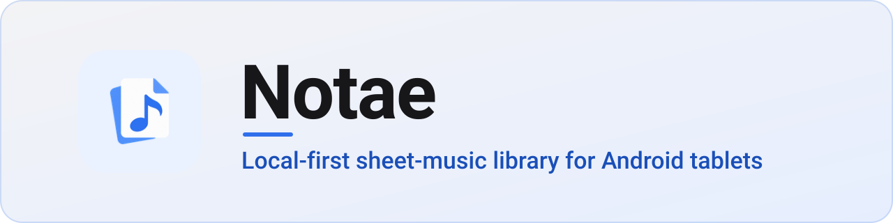
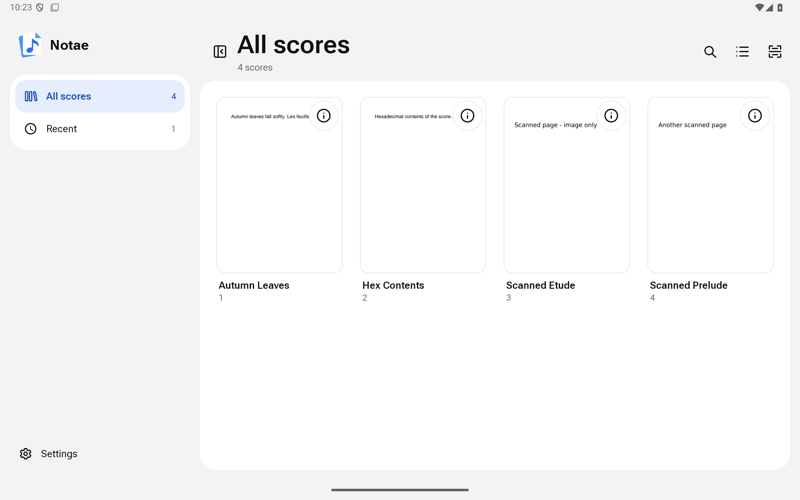
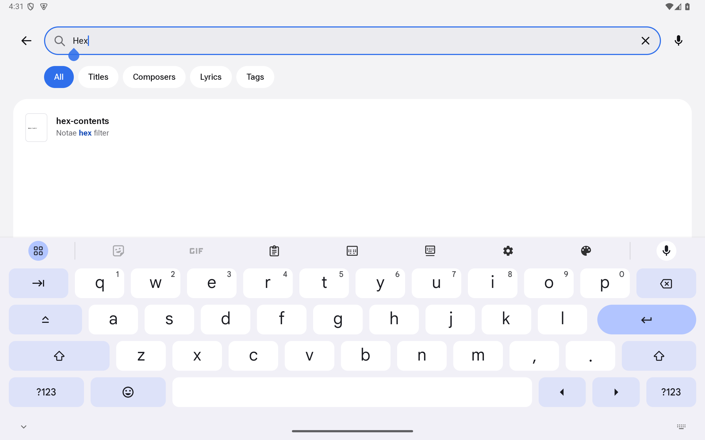
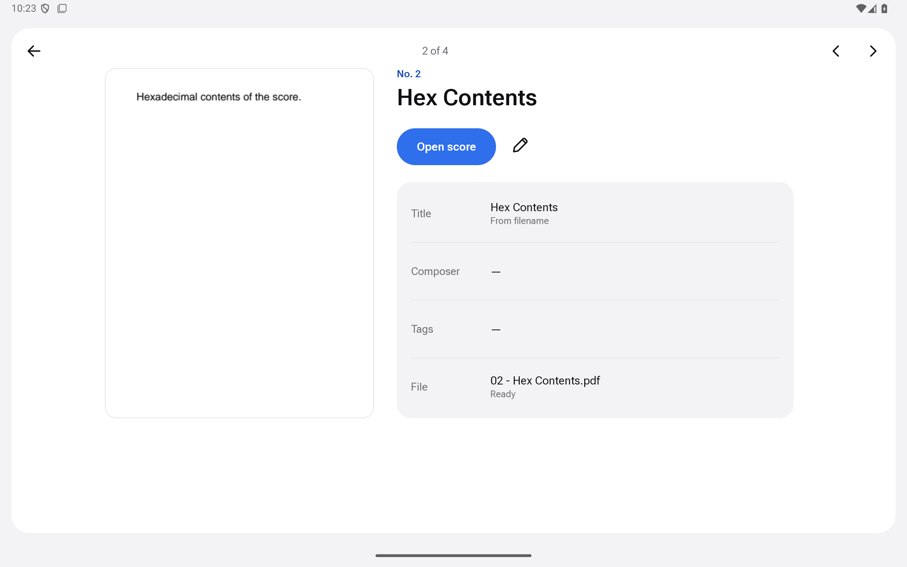
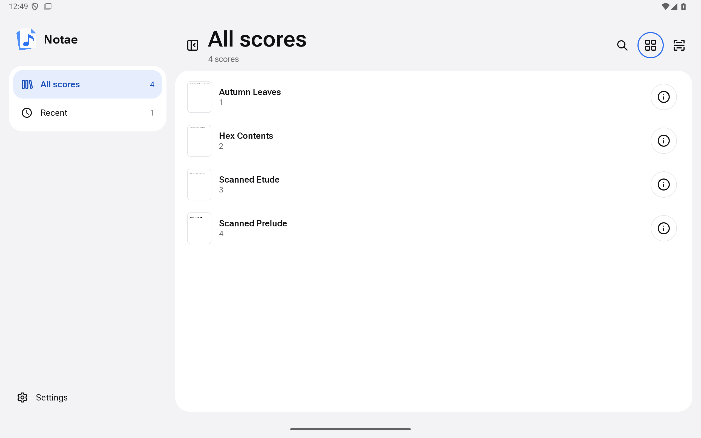
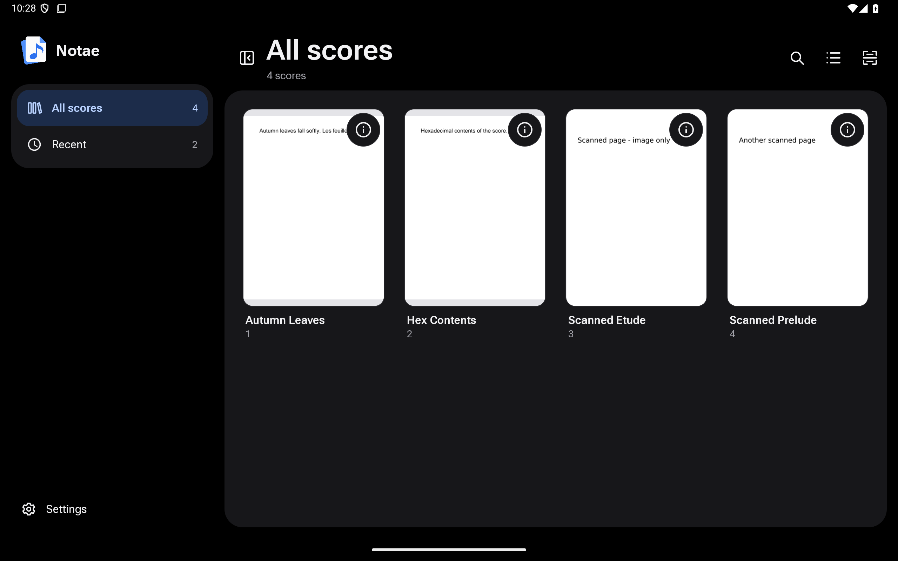
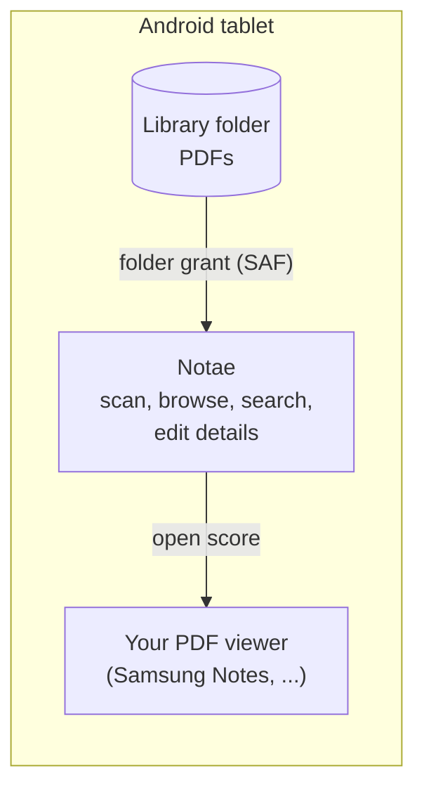

<div align="center">



**Browse and search your sheet-music PDFs on an Android tablet. No cloud, no
account, no network access.**

<sub>Version 0.5.0 · Android tablet (arm64) · one maintainer ·
<a href="ROADMAP.md">roadmap</a></sub>

[](https://github.com/eRgo35/notae/actions/workflows/ci.yml)
[](https://github.com/eRgo35/notae/releases/latest)
[](LICENSE)
[](rust-toolchain.toml)
[](#install)

[Download](https://github.com/eRgo35/notae/releases/latest) ·
[Quick start](#quick-start) ·
[Documentation](#documentation) ·
[Changelog](CHANGELOG.md) ·
[Roadmap](ROADMAP.md) ·
[Issues](https://github.com/eRgo35/notae/issues) ·
[Contributing](CONTRIBUTING.md)



<sub>Android emulator capture of a development build, with sample scores.</sub>

</div>

## Why Notae

If you keep a few hundred scanned or exported scores as plain PDFs, a file
manager gives you file names and nothing else; nothing can search the printed
text inside a scan. Notae adds a private catalogue on top of your existing
folder and leaves the PDFs exactly where they are. It does not render or
annotate scores itself: it hands each PDF to the viewer you already use.

## Features

- **Browse** as a card grid or a dense list, with a collapsible sidebar, a
  **Recent** section and a full-width **preview** with previous/next buttons.
  Light and dark themes follow the system setting. Scans are manual; Notae
  never scans in the background.
- **Search** titles, composers, tags and lyrics (the printed text), narrowed by
  scope chips, with highlighted lyric snippets. `Ctrl K` focuses search when a
  hardware keyboard is attached; a microphone action appears when Android
  provides a speech recognizer. Search ignores case and Polish diacritics:
  `ą ć ę ń ó ś ź ż` match their plain letters and `ł`/`Ł` match `l`/`L`, so
  `lodz` finds `Łódź` in titles, composers, tags and lyrics.
- **Edit details** (number, title, composer, tags). Manual edits are kept when
  a scan runs again.
- **Open scores in your PDF viewer**: Samsung Notes when installed, otherwise
  the Android PDF chooser.
- Parses `<number> - <title>.pdf` file names and re-indexes incrementally by
  SHA-256 content hash, so a renamed file stays one record.
- Reads a PDF's own text layer on-device on Android 15 (API 35) and later.
  Scanned PDFs have no searchable text until on-device OCR exists. A failing
  PDF never aborts a scan, and duplicate numbers are reported rather than
  overwritten.

## Screenshots

<table>
  <tr>
    <td width="50%">
      
      <br><sub><b>Search</b> titles, composers, tags and lyrics.</sub>
    </td>
    <td width="50%">
      
      <br><sub><b>Preview</b> with details and an <i>Open score</i> action.</sub>
    </td>
  </tr>
  <tr>
    <td width="50%">
      
      <br><sub><b>List view</b> for dense libraries.</sub>
    </td>
    <td width="50%">
      
      <br><sub><b>Dark theme</b> follows the system setting.</sub>
    </td>
  </tr>
</table>

<sub>All screenshots are real captures from an Android 15 tablet **emulator**
(2560×1600) of the v0.2.1 development build, showing sample scores, not from a
physical tablet.</sub>

## How it works

Notae reads the folder you pick through Android's Storage Access Framework and
builds its own private index from it.



Notae never syncs or uploads anything. There is no on-device OCR yet;
[ADR 0001](docs/adr/0001-on-device-ocr.md) accepts it as a manual, foreground step ([#28](https://github.com/eRgo35/notae/issues/28)), not yet built.

## Install

> [!NOTE]
> Notae is young. 0.5.0 rebuilds the app in Jetpack Compose with a new app id,
> `com.c2yz.notae`: it installs beside 0.3.0 or 0.4.0 instead of updating it.
> Use **Export sets** in the old app first and import the file on 0.5.0's
> first screen to keep your favorites and sets (see the
> [changelog](CHANGELOG.md)). Please report anything odd.

Notae ships one Android artifact: a signed **arm64** APK for Android tablets
with Android 8.0 (API 26) or newer, attached to each GitHub Release. The
release workflow builds, signs and verifies it from the release tag.

1. Download `notae-<version>-arm64.apk` and its `.sha256` from the
   [latest release](https://github.com/eRgo35/notae/releases/latest).
2. Verify it. The checksum only catches a corrupted download; the signature
   check is what proves the APK came from the Notae release key.

   ```sh
   V=0.5.0
   sha256sum -c "notae-$V-arm64.apk.sha256"
   apksigner verify --print-certs "notae-$V-arm64.apk" \
     | grep -i 'SHA-256 digest: be27cd781766c5c28a9db106c07b051ceee4e0003105964595e2a848f371f601'
   ```

   `apksigner` ships with the Android SDK build tools. The `grep` must print
   one line; if it prints nothing, do not install the APK. The same
   fingerprint, in the usual colon-separated form, is published in
   [`docs/android-release.md`](docs/android-release.md) and pinned in
   `.github/workflows/release.yml`:

   ```text
   BE:27:CD:78:17:66:C5:C2:8A:9D:B1:06:C0:7B:05:1C:EE:E4:E0:00:31:05:96:45:95:E2:A8:48:F3:71:F6:01
   ```

3. Copy the APK to the tablet and open it (allow installs from your file
   manager or browser when Android asks), or run
   `adb install "notae-$V-arm64.apk"`.

> [!WARNING]
> Installed a self-built (debug) APK before? **Uninstall it first.** Android
> will not update an app signed with a different key, and uninstalling deletes
> Notae's local data (folder access, index, metadata edits) but never your
> PDFs. Releases all use one key, so later upgrades work in place.

## Quick start

**1. Put your PDFs in a folder on the tablet.** Name them
`<number> - <title>.pdf` (for example `12 - Autumn Leaves.pdf`) to get a number
and title for free; other names work and simply have no number.

**2. Open Notae and choose the folder.** Tap **Choose score folder**, pick the
folder in the Android picker, allow access, then start a scan from the Library.
Notae indexes the PDFs. Coming from 0.3.0 or 0.4.0? Tap **Import from a
previous Notae** first and pick the file the old app's **Export sets** wrote.
The import carries your favorites and sets only: details you edited (number,
title, composer, tags) and the Recent list stay in the old app. Keep the old
app installed until you have checked that 0.5.0 has what you need.

## Using Notae

- **Browse:** use the sidebar (or the chip row on a narrow window) for All
  scores and Recent, and the header buttons for grid/list and for hiding the
  sidebar. Both choices are remembered.
- **Open:** tap a score to open it in your PDF viewer. The **⋮** (More
  actions) button on every card and row opens a bottom sheet with **Open
  score**, **Score details** (the first page and metadata) and **Edit
  details**.
- **Search:** tap the search icon (or `Ctrl K`), type, and narrow by scope chip.
- **Edit:** change number, title, composer and tags from the **⋮** sheet's
  **Edit details** or from a score's details.
  Edits live in Notae's private index and never rename the PDF.
- **Rescan** from the Library header after adding files.

## Build from source

<details>
<summary><b>Prerequisites</b></summary>

- **Rust 1.98.1**, pinned by [`rust-toolchain.toml`](rust-toolchain.toml)
  (rustup selects it automatically, with `rustfmt` and `clippy`), with the
  `aarch64-linux-android` and `x86_64-linux-android` targets and
  `cargo-ndk` 4.1.2.
- **Android toolchain:** a JDK (21 or newer), the Android SDK with platform 36,
  build-tools 36.0.0 and NDK r28c (`28.2.13676358`), and `ANDROID_HOME`
  pointing at it.

</details>

<details>
<summary><b>Build the Android app</b></summary>

```sh
rustup target add aarch64-linux-android x86_64-linux-android
cargo install --locked --version 4.1.2 cargo-ndk

cd apps/notae-android
./gradlew assembleDebug     # debug-signed APK, arm64-v8a and x86_64 (emulator)
./gradlew assembleRelease   # unsigned arm64 release APK
```

Gradle builds the Rust core with cargo-ndk and generates its Kotlin bindings
with UniFFI. Debug builds are signed with your Android SDK debug key, so they
are **not** update-compatible with the official release APK. Release builds
are signed only by the release workflow
([`docs/android-release.md`](docs/android-release.md)). See
[`docs/android-debugging.md`](docs/android-debugging.md) for emulator setup.

</details>

`scripts/check.sh` runs the quality gates (format, Clippy, tests, docs,
`cargo deny`, coverage, and the Gradle lint, tests, screenshot checks and
release build); see [`CONTRIBUTING.md`](CONTRIBUTING.md#quality-gates).

## Project layout

```text
crates/
  notae-domain/     Filename convention, note metadata, file identity.
  notae-index/      SQLite persistence, FTS5 search and the
                    rescan reconciler.
  notae-app-core/   The app logic (state, stores, browse, search, sets,
                    scans) behind a UniFFI API for the Kotlin app.
apps/
  notae-android/    The Android app (Gradle): Jetpack Compose UI and the
                    Storage Access Framework, PDF and speech platform code.
docs/               Release procedure, engineering standards, debugging guide,
                    design spec and plans.
```

The UI is Kotlin with Jetpack Compose; the app logic is Rust. Domain logic,
indexing, search, sets and the screen state live in the host-tested crates;
the Kotlin app draws the core's snapshots and adds the platform code. The product scope and
architecture are in the
[design spec](docs/superpowers/specs/2026-10-09-notae-design.md).

## Privacy & security

- **No network access by Notae.** The Android manifest requests no Android
  permissions, so there is no `INTERNET` permission. Check an APK yourself:
  `aapt2 dump permissions notae-$V-arm64.apk` prints only the package name and
  AndroidX's `DYNAMIC_RECEIVER_NOT_EXPORTED_PERMISSION`, an app-private
  permission that keeps the app's internal broadcasts to itself.
  The Rust core's Android dependency graph
  (`cargo tree -p notae-app-core --no-default-features --target aarch64-linux-android`)
  contains no HTTP client, TLS or async-network crates. There are no accounts and no
  telemetry.
- **No broad storage access.** Notae reads only the folder you pick through
  Android's Storage Access Framework, and only reads from it.
- **PDFs are never modified.** They are not copied, moved, renamed or
  rewritten. The index and thumbnails live in the app's private storage.
- **Handing a score to a viewer** grants that app temporary read access to that
  one PDF.
- **Voice search** is optional: it only launches Android's installed speech
  recognizer. That recognizer is not part of Notae and may use network services
  independently; Notae requests no microphone permission.
- **Signed releases.** APKs are built from version tags and signed with a
  dedicated key whose fingerprint is published (see [Install](#install)).

Found a vulnerability? Follow [`SECURITY.md`](SECURITY.md) and report it
privately.

## Documentation

- [`ROADMAP.md`](ROADMAP.md): what is being built now, next and later.
- [`GLOSSARY.md`](GLOSSARY.md): the domain terms (library, score, scope,
  set, ...).
- [`CONTRIBUTING.md`](CONTRIBUTING.md#development-workflow): setup, quality
  gates and the development workflow from issue to release.
- [`docs/android-release.md`](docs/android-release.md): cutting a release,
  signing and verification.
- [`docs/android-debugging.md`](docs/android-debugging.md): emulator setup,
  crash-log capture and the UI verification checklist.
- [`docs/engineering-standards.md`](docs/engineering-standards.md): quality
  gates and standards audit.
- [`docs/release-notes/`](docs/release-notes/) and
  [`CHANGELOG.md`](CHANGELOG.md): what changed in each release.

## Contributing

Bug reports, ideas and pull requests are welcome. Start with
[`CONTRIBUTING.md`](CONTRIBUTING.md) for the development setup, quality gates,
commit conventions and what must never be committed.

## Known limitations

What comes next is in [`ROADMAP.md`](ROADMAP.md).

- **0.5.0 is verified with host tests, screenshot tests and the tablet
  emulator;** the Galaxy Tab S10 FE+ check is pending.
- **No on-device OCR.** Scanned PDFs are found by file name only
  ([#28](https://github.com/eRgo35/notae/issues/28),
  [ADR 0001](docs/adr/0001-on-device-ocr.md)). The desktop indexer and its
  OCR were removed in 0.5.0.
- **Platforms:** Notae is Android tablets only, and the release is arm64 (minSdk 26).
  There is no desktop, iOS, Windows or macOS build, and no phone layout.
- **No in-app PDF viewing or annotation, and no cloud sync**, by design.
- Preview thumbnails are 400 px wide, so the full-width preview can look soft
  on a large tablet.

## License

Notae is released under the [MIT License](LICENSE). Third-party dependencies
keep their own licenses; for the Rust crates the accepted set is enforced by
`cargo deny` ([`deny.toml`](deny.toml)).
