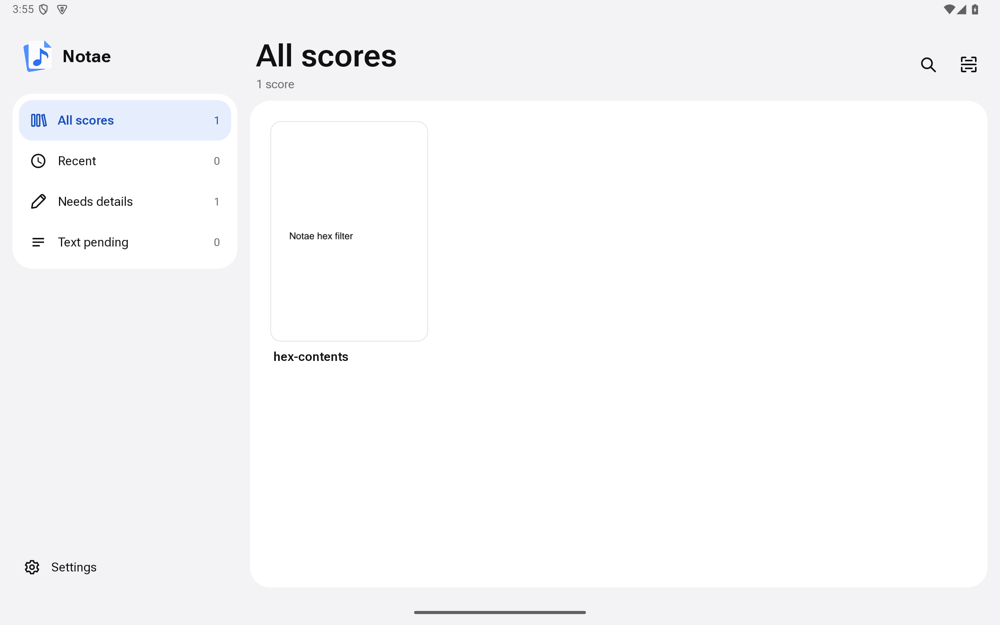
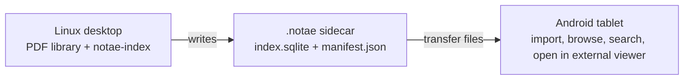
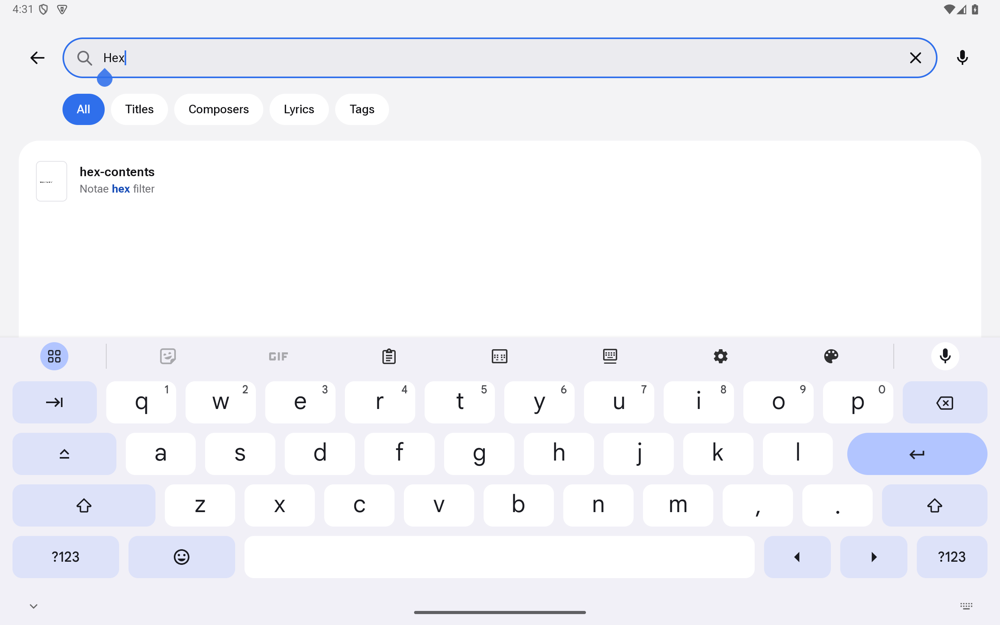
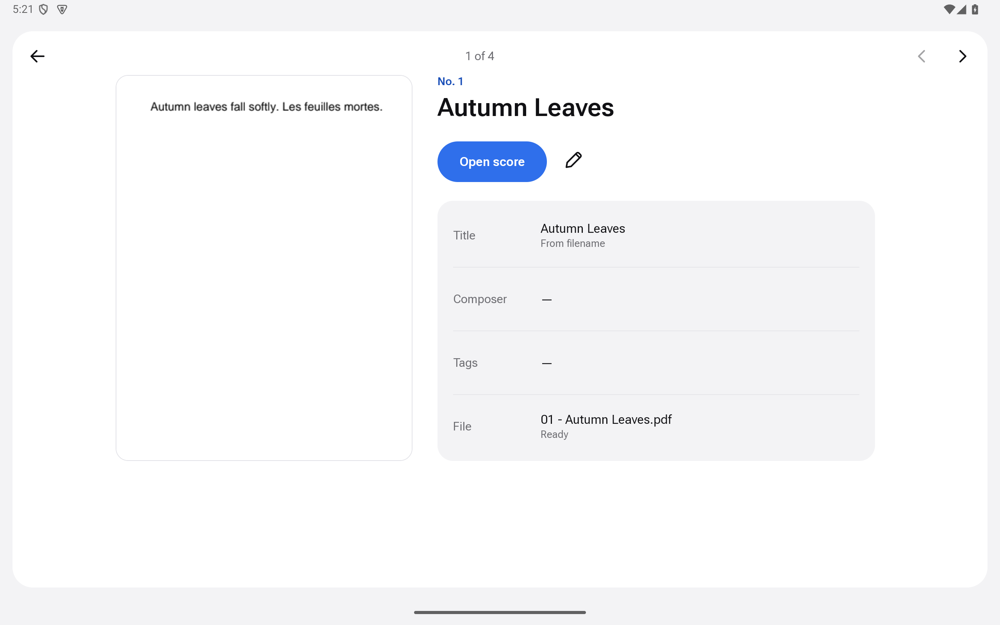

# Notae


Notae keeps a personal sheet-music library organized: index PDFs on a Linux
desktop, then browse and search them on an Android tablet. Open PDFs in an
external Android viewer to read or annotate them. The desktop and tablet need
not share a filesystem; they exchange a versioned sidecar manifest.

[](https://github.com/eRgo35/notae/actions/workflows/ci.yml)
[](LICENSE)
[](rust-toolchain.toml)



*All scores in the Android app. Emulator capture using a non-sensitive fixture library.*

## What Notae does

- **Index on desktop:** catalog PDFs into SQLite and extract text with Tesseract
  OCR where needed.
- **Share a portable sidecar:** write a versioned manifest beside the index;
  transfer it through your preferred file-sharing method.
- **Browse and search on tablet:** import the sidecar and find scores by title,
  composer, lyrics, or tags. Open PDFs in an external Android viewer to read
  or annotate them.



## Quick start

1. Install Rust 1.98.1 (the workspace-pinned toolchain), `pkg-config`, and
   Tesseract and Leptonica development libraries plus at least one Tesseract
   language pack (for example, English). See the [OCR setup
   guide](crates/notae-ocr/README.md) for platform-specific prerequisites.
2. Index a directory containing PDFs:

   ```sh
   cargo run -p notae-index-cli -- /path/to/library
   ```

   The indexer creates `/path/to/library/.notae/` with `index.sqlite` and
   `manifest.json`. Use `cargo run -p notae-index-cli -- --help` for the
   supported options.
3. Transfer the `.notae/` sidecar and the corresponding PDFs to the tablet,
   then open Notae and import the sidecar. The files can be transferred by
   USB or another method you choose; Notae does not sync devices over a
   network.

The screenshots below show actual emulator captures. They are labeled
**emulator** because they were taken on an Android emulator, not a physical
tablet; tablet captures may replace them after on-device verification.

### Search (Android emulator)



*Search for “Hex” with the non-sensitive fixture score `hex-contents`.*

### Score preview (Android emulator)



*Full-width preview of the non-sensitive fixture score “Autumn Leaves”, with
previous/next browsing. Android emulator capture, not a tablet screenshot.
Notae shows the preview and details; the PDF opens in an external viewer.*

## Workspace layout

```text
crates/
  notae-domain/     Filename convention, note metadata, file identity.
                    The types every other crate imports.
  notae-index/      SQLite persistence, FTS5 search, the sidecar
                    format, and the importer the Android app uses.
  notae-ocr/        Tesseract-backed OCR provider. See
                    crates/notae-ocr/README.md for the dev-env setup.
apps/
  notae-index/      The `notae-index` binary. See apps/notae-index/README.md.
  notae-android/    Android application and tablet UI. See
                    docs/android-debugging.md for build and device checks.
```

## Build and quality gates

The Rust workspace is pinned to 1.98.1 in `rust-toolchain.toml`. On Linux,
install `pkg-config`, Tesseract development headers, and Leptonica development
headers first. Fedora/RHEL hosts without system pkg-config files can follow
[`crates/notae-ocr/README.md`](crates/notae-ocr/README.md) and set
`PKG_CONFIG_PATH=/tmp/tesseract-pkgconfig` for Cargo commands.

The exact local gates run in CI; commands and Android target setup are listed
in [`docs/engineering-standards.md`](docs/engineering-standards.md):

```sh
cargo fmt --check
cargo clippy --workspace --all-targets -- -D warnings -A clippy::unwrap_used -A clippy::expect_used
cargo clippy --workspace --lib --bins -- -D warnings -D clippy::unwrap_used -D clippy::expect_used
cargo test --workspace
RUSTDOCFLAGS="-D warnings" cargo doc --workspace --no-deps
cargo deny check
cargo llvm-cov --workspace --summary-only --fail-under-lines 84
cargo run -p notae-index-cli -- --help
```

`notae-ocr` is the only crate that requires Tesseract and Leptonica headers.
The Android arm64 target has a separate CI compile gate; installing and
visually checking the app on the Galaxy Tab S10 FE+ remains a manual step.

## Where to read more

* [`apps/notae-index/README.md`](apps/notae-index/README.md) —
  Linux indexer user guide, prerequisites, invocation, sidecar
  format, and the Android import contract.
* [`crates/notae-ocr/README.md`](crates/notae-ocr/README.md) —
  the dev-env setup for building against a system Tesseract and
  Leptonica on Fedora / RHEL.
* [`docs/android-debugging.md`](docs/android-debugging.md) — safe crash-log
  capture and native debugging for the Samsung Android app.
* [`docs/engineering-standards.md`](docs/engineering-standards.md) — local
  quality commands, Android target gate, and standards audit.

## Target device

The Android side targets the **Samsung Galaxy Tab S10 FE+** with
the latest Samsung keyboard cover. The desktop side targets a
Linux box the user keeps near the printer; it does not have to
be the same hardware across users.
