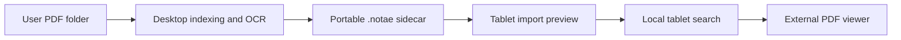

# Notae v0.2.0 Release Implementation Plan

> **For agentic workers:** REQUIRED SUB-SKILL: Use superpowers:subagent-driven-development or superpowers:executing-plans to implement this plan task-by-task. Steps use checkbox (`- [ ]`) syntax for tracking.

**Goal:** Resolve the twenty tablet-feedback issues and CI repair #21 in the [v0.2.0 milestone](https://github.com/eRgo35/notae/milestone/1), then ship a verified Android release.

**Architecture:** Keep Rust `UiModel` and the operation worker authoritative; Slint renders state and dispatches actions through the existing callbacks. Extend the existing private-file persistence and Java/JNI activity-result patterns, rather than introducing another UI stack or copying PDFs. Implement the workstreams below sequentially because they share `app.slint`, `components.slint`, `ui.rs`, and `android_main.rs`.

**Tech Stack:** Rust 1.98.1 / edition 2024, Slint 1.18.1, SQLite FTS5, Android SDK Java/JNI, cargo-apk2.

**Spec:** [Issues #1–#20](https://github.com/eRgo35/notae/issues?q=is%3Aissue+milestone%3Av0.2.0), including their acceptance criteria; `docs/superpowers/specs/2026-10-09-notae-design.md`. This plan supersedes contradictory motion, header-action, details-pane, and Settings decisions in the October 14 UI plans. Original issue bodies remain the acceptance contract; hypotheses are not confirmed diagnoses.

## Scope and current state

- Planning baseline: `13869a2`, following the tablet build `4876f98` referenced by the issues.
- The maintainer approved preparation through the finished implementation plan. This document does not authorize or claim implementation, a version bump, a tag, or a published release.
- All twenty issues are open and assigned to milestone `v0.2.0`. #2 and #13 are tablet-led investigations; #17 needs human accessibility validation (`ready-for-human`). The remaining seventeen issues have `ready-for-agent` implementation slices, but final tablet verification still applies.
- The maintainer subsequently requested implementation of [#21: restore GitHub Actions host and Android checks](https://github.com/eRgo35/notae/issues/21). This CI repair is authorized now; the application tasks below retain their original preparation-only status.
- One integrated plan replaces the initially proposed separate workstream documents. This keeps shared interfaces and sequencing in one place. The parallel plan-writing workers failed with provider HTTP 429 errors before saving plan files.
- `Screenshot_20261015_215628_One UI Home.jpg` is truncated. ImageMagick reports `Premature end of JPEG file` and `premature end of data segment`. Preserve it as original issue evidence, not as a valid README screenshot or visual baseline. Request a replacement on #7; no tablet was connected when the original artifact was inspected.

## Global constraints

- Use workspace-pinned Rust **1.98.1**. Keep Android **min SDK 23**, **target SDK 34**, and the arm64 build target.
- Fully local: no telemetry or application network traffic. Voice recognition is an explicit hand-off to an installed system recognizer, which may have its own network/privacy policy; do not describe that external service as offline.
- Never copy, rename, or move library PDFs. Private index, thumbnails, recent history, and UI preferences stay under `internal_data_path()/notae/`.
- No unchecked `unwrap`/`expect` in new production code. Host modules forbid unsafe; preserve only the documented Android entry-point FFI exception.
- No new production crate dependency unless essential to a demonstrated fix. One pinned test backend is allowed for behavioural UI tests; run `cargo deny check` after dependency changes.
- Touch targets at least **48×48 logical px**. Text contrast at least **4.5:1**, non-text graphical contrast at least **3:1**, in light and dark.
- Derive adaptive dimensions from the window, not child intrinsic sizes. No binding loops.
- Pending text is an index state, not a running Android OCR job. Explain the actual next action.
- Delete source-text assertion tests for changed UI; do not replace one string snapshot with another. Test behaviour or verify visually.
- Every behavioural task updates the corresponding description/checks in `docs/android-debugging.md`, runs its focused checks, and exercises the changed surface before committing.
- Do not close a device-dependent issue solely because a host test or Android compile passes. Keep its acceptance gate open until observed on the required device.

## Release sequencing and acceptance coverage

| Order | Workstream / task | Issues | Required outcome |
|---|---|---|---|
| 0 | CI prerequisite repair | #21 | Both GitHub Actions jobs pass without weakening any gate |
| 1 | Host UI test seam | supports all UI tasks | Real generated UI usable under a headless backend; no source-grep tests |
| 2 | Settings and welcome | #8, #9, #11, #12 | Compact intro/settings; truthful maintenance/About; no Settings header Scan |
| 3 | Search affordances | #4, #5 | Hardware-only shortcut keycap; voice input; no Search header Scan |
| 4 | Startup and input | #1, #2, #3, #13 | No startup flash/chip drift; correct first caret and Polish input |
| 5 | Motion | #10 | Shared-duration screen/sheet/selection transitions; animation-scale zero honoured |
| 6 | Library layout and preferences | #14, #20 | Persisted grid/list and collapsible sidebar |
| 7 | Preview and item actions | #15, #16, #17 | Full-width preview; Recent direct open; accessible edit/context actions |
| 8 | Themed scrollbars | #19 | Draggable, auto-hiding library/detail scrollbar |
| 9 | Operation status | #18 | Real phase/progress across screens; truthful pending labels |
| 10 | Launcher branding | #7 | Page/background contrast; matching legacy/themed icons |
| 11 | README presentation | #6 | Real screenshots, badges, overview, workflow, quick start |
| 12 | Release qualification | all | Quality gates + actual device acceptance + release artifacts |

Do not parallelize edits to shared UI/bridge files. Independent investigation/capture work may run concurrently after the corresponding interface owner lands.

### Task 0: Restore CI prerequisites (#21)

**Files:** `.github/workflows/ci.yml`, `apps/notae-index/src/catalog.rs` (directory replacement fixture), `docs/engineering-standards.md`, this plan and `docs/superpowers/IMPLEMENTATION-STATE.md`.

**Evidence:** [Run 38802755183](https://github.com/eRgo35/notae/actions/runs/38802755183) fails host Clippy because `yeslogic-fontconfig-sys` cannot find `fontconfig.pc`. The Android job fails earlier because `android-actions/setup-android@v3` defaults to installing the retired SDK package `tools`.

The first repair run [38806450766](https://github.com/eRgo35/notae/actions/runs/38806450766) passed Android and both host Clippy gates, then exposed `a_subdirectory_is_not_opened_once_it_is_replaced`: deleting/recreating the directory permits inode reuse. Rename the original aside before creating the replacement (as the adjacent root replacement test already does), preserving the identity-refusal assertion and production behaviour.

- [x] Install `libfontconfig1-dev` alongside the existing OCR development dependencies on the Ubuntu host job.
- [x] Explicitly set the Android action's packages to `platform-tools platforms;android-34 build-tools;34.0.0`; retain the existing NDK r26d and Rust/cargo-apk2 pins.
- [x] Document both prerequisites. Do not disable host features, suppress compiler failures or lower coverage to obtain green CI.
- [ ] Make the directory replacement fixture deterministic without changing the filesystem identity check; verify the focused regression and workspace suite.
- [ ] Push the repair and observe both jobs through completion. Diagnose any newly exposed gate failure from its logs and fix it before closing #21.
- [ ] Record the successful run URL on #21 and update release status. No Android UI acceptance is implied by a passing compile.


## Current interfaces and file ownership

| Files | Current responsibility | Planned change |
|---|---|---|
| `apps/notae-android/src/lib.rs`, `build.rs` | Generated bindings currently included only on Android; build script compiles `ui/app.slint` | Host test access, debug element metadata for host builds, build identity |
| `apps/notae-android/src/ui.rs` | `UiModel`, `UiStatus`, storage/operation projection, recent/selected score | Loading, preferences, navigation and status projection |
| `apps/notae-android/src/state.rs` | `AppState`, `OperationState`, controller transitions | Loading/operation phase transitions only where required |
| `apps/notae-android/src/android_main.rs` | `run`, `sync_window`, Java/platform callback wiring | Restore ordering, preferences, hardware/voice/motion bridge |
| `apps/notae-android/android/src/main/java/org/notae/android/NotaeActivity.java` | NativeActivity; folder result routing; thumbnail renderer | Distinct voice result routing; configuration/platform facts |
| `apps/notae-android/src/picker_fut.rs`, `src/android/saf.rs` | Existing JNI result handshake and persisted root | Preserve picker semantics while adding voice handling |
| `apps/notae-android/ui/components.slint` | Theme, fields, chips, controls | Keycap, motion tokens, context actions, scrollbar |
| `apps/notae-android/ui/setup.slint` | Welcome and Settings | Compact layouts and maintenance/About |
| `apps/notae-android/ui/search.slint` | Search header, scope chips, results | Keycap/mic, stable chips, correct focus |
| `apps/notae-android/ui/library.slint` | SidePanel, ScoreGrid, OperationBanner | ScoreRow, toggles, actions and scrollbars |
| `apps/notae-android/ui/details.slint`, `ui/app.slint` | Details/list composition and modal sheets | Full-width preview, transitions, shared status projection |
| `apps/notae-android/src/operations/events.rs`, `rescan.rs` | Worker progress/finalization/completion and sidecar preview | Explicit real phases; no early completion before outstanding work |
| `apps/notae-android/src/recent.rs` | `from_text`, `to_text`, `load`, atomic temp/rename `save` | Reuse this convention for UI preferences |
| `apps/notae-android/src/ui/browse.rs` | Sections, `section_rows`, Recent order | Navigation boundaries and item action context |
| `crates/notae-index/src/store.rs` | FTS schema/tokenizer | Verify Unicode behaviour, no speculative schema migration |
| `apps/notae-android/android/res/` | Adaptive, legacy, monochrome icons | Consistent icon contrast |
| `README.md`, `docs/images/` | Technical presentation and future screenshots | Presentation before existing engineering reference |

## Shared interfaces and product decisions

### C0: Host UI tests

Task 1 owns `tests/support/mod.rs`:

```rust
pub fn app() -> notae_android::AppWindow;
pub fn app_sized(width: f32, height: f32) -> notae_android::AppWindow;
```

These initialize a headless backend per test thread. `app()` selects a configured 1280×800 Library; `app_sized` sets a logical viewport. Tests import the helper with `mod support;` and retain the window on its creating thread. Pin the test backend to the resolved Slint version, initially `i-slint-backend-testing = "=1.18.1"`. Advance timers with `mock_elapsed_time(Duration::from_millis(n))`, not sleeping. Confirm the backend's API against its resolved source before committing the harness.

### C1: Private UI preferences

Task 6 owns a new `src/ui_prefs.rs`, following `recent.rs`:

```rust
#[derive(Debug, Clone, Copy, Default, PartialEq, Eq)]
pub enum LibraryView { #[default] Grid, List }

#[derive(Debug, Clone, PartialEq, Eq)]
pub struct UiPrefs {
    pub library_view: LibraryView,
    pub sidebar_collapsed_portrait: bool,
    pub sidebar_collapsed_landscape: bool,
}

impl Default for UiPrefs {
    fn default() -> Self {
        Self {
            library_view: LibraryView::Grid,
            sidebar_collapsed_portrait: true,
            sidebar_collapsed_landscape: false,
        }
    }
}
```

Expose `from_text(&str) -> Self`, `to_text(&self) -> String`, `load(&Path) -> Self`, and `save(&self, &Path) -> io::Result<()>`. File: `notae/ui-prefs.txt`. Keys: `library_view=grid|list`, `sidebar_collapsed_portrait=true|false`, `sidebar_collapsed_landscape=true|false`. Ignore unrecognized/invalid entries without losing valid entries. Default absent/corrupt values individually. Save through a sibling temporary file and rename; report save failure without discarding the in-memory user choice. Portrait means logical window height greater than width; persist choices separately so collapsing portrait does not silently change landscape.

### C2: Motion

Task 5 owns these `Theme` properties:

```slint
in-out property <bool> animations-enabled: true;
out property <duration> motion-short: animations-enabled ? 120ms : 0ms;
out property <duration> motion-medium: animations-enabled ? 220ms : 0ms;
```

Android `Settings.Global.ANIMATOR_DURATION_SCALE == 0` disables motion. Read at startup and resume; do not require privileged settings writes. A read failure leaves motion enabled. No new Motion preference. Use the short token for state changes/scrollbar fade, medium for screen/sheet transitions.

### C3: Final header/actions contract

- Library: sidebar toggle when the wide layout is available, title/count, Search, grid/list toggle, Settings as required by current compact layout, Scan right-most. Empty-state Scan remains.
- Search: Back, field (empty + hardware keyboard ⇒ Ctrl K keycap), microphone only if a recognizer exists. No Scan.
- Settings: Back and title only. A compact Scan action lives inside Library maintenance, not in the header.
- #5's instruction to keep Settings Scan and #12's instruction to keep Search Scan are superseded by applying both requested removals together.

### C4: Library selection/actions

`ScoreGrid` and new `ScoreRow` expose item callbacks `select(string)`, `open(string)`, `edit(string)`, and `long-pressed(string)`, all carrying the stable content key. Route to existing `score_selected`, `open_pdf_requested(relative_path, note_key)`, and `edit_metadata_requested(note_key)` semantics rather than duplicating launch/editor logic.

- Grid/List is persisted globally, not per section.
- Preview is transient and full width: no sidebar and no companion `ScoreList`. Open from either persisted layout; Back restores that layout. Previous/next follow the current section's row order, without wrapping at boundaries.
- Recent tap opens the PDF directly; the visible **Score details** info action opens preview. Other sections still tap to preview.
- Edit icon is visible on every card/list row with accessible name **Edit details**. Long-press opens **Open score**, **Score details**, **Edit details** after 500 ms; movement into a scroll, release before timeout, modal opening, or navigation cancels it. Consuming long-press must not also fire the tap.
- A visible Slint button is not proof of TalkBack support. #17's TalkBack acceptance is a release gate, not waived by this plan; see Task 7.

### C5: Status and pending text

`OperationBanner` remains the sole operation component. Keep the existing `progress-text`, `busy`, `failed`, `fraction`, `cancel-enabled`, `acknowledge-enabled` interface until Task 9 owns the phase change. Render the same projected state across Library/Search/Settings; do not add three independent progress state machines.

Evidence from `operations/rescan.rs`: after `RescanFinalizing`, the per-file loop extracts embedded text and renders thumbnails, emits `Progress`, prunes thumbnails, and projects rows. It emits `Completed` **before** looking for and preparing a sidecar preview. Therefore some real sidecar work can follow the apparent completion; Android OCR does not. Task 9 must make that ordering truthful.

## Execution protocol for every task

1. Read the named symbols, issue body/comments, and earlier task's landed interface. Do not copy stale line numbers from this plan.
2. Add a behavioural regression only where it catches a plausible user-visible failure; run it to observe the expected failure before implementing. Visual-only changes use a before/after emulator scenario instead of source-text assertions.
3. Implement the smallest change, migrate every affected callback/test/doc, and remove obsolete plumbing.
4. Run the named focused check, then launch/install and exercise the changed path. Capture visual evidence for UI changes.
5. Update `docs/android-debugging.md`. Commit with the suggested Conventional Commit summary and reference the relevant issues. Use `Closes #N` only after the issue's acceptance gates are actually met; otherwise use `Refs #N`.

This plan intentionally does not prescribe a guessed patch for #2/#13: their fix is selected by the diagnostic decision tree in Task 4, with the same issue acceptance required afterward.

## Task 1: Establish a behavioural UI test seam

**Files:** `apps/notae-android/{Cargo.toml,build.rs,src/lib.rs}`, create `tests/support/mod.rs`; replace source-grep tests in `tests/details_ui.rs` with behaviour tests in `tests/headers_ui.rs` only where useful.

**Consumes:** Existing generated `AppWindow` and public properties. **Produces:** C0; no product behaviour changes.

- [ ] Add pinned `i-slint-backend-testing` as a dev dependency. Make the generated bindings available on host (remove only the Android cfg from the generated include, not from Android modules). Configure Slint debug element metadata on non-Android builds so UI element lookup is available to tests; keep Android build unaffected.
- [ ] Build C0 helpers using the testing backend's `init_no_event_loop()` and `slint::ComponentHandle`; set logical window size and configured state. Verify independent tests can initialize their own threads without cross-thread UI access.
- [ ] Replace the existing source-grep tests with a real interaction test: open Library then Settings and verify the header/action surface through accessible elements. Do not pin header strings that later tasks intentionally remove.
- [ ] Run `cargo test -p notae-android --test headers_ui` and `cargo deny check`; expected: the test runs the generated component, dependency checks succeed or report actionable findings, and there are no new runtime dependencies. Run the Android arm64 check to catch target-specific feature regressions.
- [ ] Commit `test(android): exercise generated UI through a headless backend`.

## Task 2: Compact Settings and welcome (#8, #9, #11, #12)

**Files:** `ui/setup.slint`, `ui/app.slint`, `src/ui.rs`, `src/android_main.rs`, `build.rs`, `tests/headers_ui.rs`, `tests/smoke.rs`, `tests/storage_state.rs` under `apps/notae-android/`; `docs/android-debugging.md`.

**Consumes:** C0, `UiStatus.latest_rescan: Option<RescanSummary>`, existing library row projection. **Produces:** C3 Settings header; compact screen with real maintenance/About facts.

- [ ] Before changing layout, capture Welcome, recovery and Settings at portrait/landscape and a short landscape viewport. Record actual layout, not just a Slint source screenshot.
- [ ] Welcome: reduce the paragraph→feature-card gap to 12 px; avoid changing all other gaps unnecessarily. Reduce tall-window top padding so the intro/card/action read as one group. Keep short windows scrollable; test recovery copy as well as first-run copy.
- [ ] Settings: set card padding to 16 px. Put folder display name and compact **Change** action on one row, wrapping the name rather than hiding the action. Remove text-extraction/pending paragraph and standalone privacy card.
- [ ] Replace maintenance prose with indexed count and available scan result/conflict/failure rows plus compact **Scan**. `RescanSummary` has counts but no timestamp; show **No scan this session** when absent, not a fabricated last-scan time. Indexed count must come from the complete library, not the currently filtered Search/Recent rows. Add a worker projection if the full count is not available.
- [ ] About shows version, build identity, MIT, repository URL, sidecar schema version and one privacy line. Use `notae_index::sidecar::SIDECAR_SCHEMA_VERSION` (currently 2), not a duplicated literal. Show indexed count once, in maintenance; it need not be repeated in About. Build identity comes from a checked `git rev-parse --short HEAD` in `build.rs`, falling back to **unknown** for source archives; emit rerun tracking for Git HEAD/ref changes so incremental builds do not retain a stale hash. Keep repository information visible without adding application networking.
- [ ] Remove Settings header `ScanButton` and unused header-only properties/callbacks; retain maintenance Scan connected to the existing `rescan_clicked` operation path.
- [ ] Test Settings with no summary, failure/conflict summary and long folder name. Check Change and maintenance Scan are reachable; scan enablement/cancellation semantics remain unchanged. Run `cargo test -p notae-android --test headers_ui`, `--test smoke`, `--test storage_state` separately. Expected: no stale header/source-copy assertions.
- [ ] Install and inspect light/dark portrait/landscape, with large text and short viewport; no clipping or broken wrap dimensions. Update the manual screen description/checks.
- [ ] Commit `fix(android): compact welcome and redesign Settings` (Refs #8, #9, #11, #12).

## Task 3: Hardware shortcut hint and voice search (#4, #5)

**Files:** `ui/{components,search,app}.slint`, `src/android_main.rs`, `src/android/mod.rs`, new `src/android/search_input.rs`, new `src/voice_search.rs`, `src/lib.rs`, `NotaeActivity.java`, Android metadata in `Cargo.toml`, packaged `android/AndroidManifest.xml`, `ui/material-icons/mic.svg`, `tests/headers_ui.rs`, create `tests/voice_search.rs`.

**Consumes:** C0, existing search change callback and Java folder-result handshake. **Produces:** C3 Search header and host-testable voice result routing.

- [ ] Add Android keyboard-presence read: `Configuration.keyboard == KEYBOARD_QWERTY && hardKeyboardHidden == HARDKEYBOARDHIDDEN_NO`. Recheck on opening Search and on keyboard configuration changes. Include `keyboard` with existing `keyboardHidden` in both manifest representations so attaching/detaching a cover does not unexpectedly recreate state.
- [ ] Add `hardware_keyboard_present` to `AppWindow` and pass it to SearchField. Remove the Ctrl K sentence from Search empty copy. The faint keycap is inside the field only when empty + hardware present; reserve its width so it cannot overlap placeholder, typed text or clear control. Typing hides the hint immediately.
- [ ] Remove Search header Scan and its unused forwarding. Keep shared progress/cancel/result controls. Flip the header behaviour test to assert Scan is available from Library and Settings maintenance, not Search/Settings headers.
- [ ] Introduce a voice-specific request code distinct from the folder picker. In Java, branch on that code before the generic URI handler; consume `RecognizerIntent.EXTRA_RESULTS` on successful result and send its first nonblank phrase through a separate native voice callback. Call `super.onActivityResult` as before. Never treat a speech result as a SAF URI/grant.
- [ ] Check recognizer availability with `resolveActivity`; add a speech intent query to Cargo Android metadata and the static manifest. Hide microphone when absent. Launch `ACTION_RECOGNIZE_SPEECH`, free-form language model, current device locale; no RECORD_AUDIO permission. Handle ActivityNotFound after the check without changing the query.
- [ ] Return native results to the Slint/UI thread, then invoke the same query update/search path as typed input. Cancellation, empty result, unrelated request code, and late results after window destruction must leave the query unchanged.
- [ ] Host-test the result decision at the Rust seam with these concrete cases:

```rust
// Proposed host seam in src/voice_search.rs:
// pub fn recognized_query(result_ok: bool, results: &[String]) -> Option<&str>
#[test]
fn canceled_recognition_does_not_replace_the_query() {
    assert_eq!(recognized_query(false, &["Chopin".into()]), None);
}
#[test]
fn successful_phrase_preserves_polish_text() {
    assert_eq!(recognized_query(true, &["Łódź pieśń".into()]), Some("Łódź pieśń"));
}
```

- [ ] Run `cargo test -p notae-android --test voice_search`, `--test headers_ui`, and `--test search_state`, then arm64 check. On emulator/tablet exercise recognizer available/unavailable, successful phrase, cancellation, keyboard attached/detached and query clearing. Confirm no mic permission request appears and no picker callback is broken.
- [ ] Update docs, commit `feat(search): add voice input and contextual keyboard hint` (Refs #4, #5).

## Task 4: Startup and input correctness (#1, #2, #3, #13)

**Files:** `src/{android_main,ui,state}.rs`, `ui/{app,components,search,library}.slint`, `NotaeActivity.java`, Android theme resources, `tests/{smoke,search_state,storage_state}.rs`; relevant index search tests around `crates/notae-index/src/store.rs`; Slint dependencies only if an evidenced upgrade is required.

**Consumes:** C0 and Task 3 Search field. **Produces:** Explicit loading projection and stable input interaction. #2/#13 remain tablet-led until reproduced and verified.

### 4A: Saved-root startup (#1)

- [ ] Record a cold launch with an already-selected library, then resume separately. Identify whether the unwanted frame is Welcome, empty Library or Android window background. `run` currently calls `sync_window` immediately after `AppWindow::new`; saved-root restore happens later. Do not assume this ordering alone proves the visible frame's origin.
- [ ] Add a host-testable startup presentation state: `Restoring`, `LoadingRows`, `Ready`. Resolve saved root before projecting setup; stay neutral while loading the first worker rows. Missing root ⇒ real setup; revoked permission ⇒ recovery; first rows (including empty) ⇒ ready. Worker startup/query failure ⇒ an explicit actionable failure, not an endless neutral screen. Do not use an arbitrary timeout to hide failures.
- [ ] In `app.slint`, loading shows only the app background/loading indication, not Welcome or the empty-library call to action. Match the Java/Android pre-first-frame window background to theme light/dark so native splash handoff does not flash another colour.
- [ ] Add state tests for saved valid root before first rows, empty first rows, no saved root, revoked grant and worker failure. Run focused storage/smoke tests; cold-launch record must show no Welcome/empty-library frame for a populated saved library.
- [ ] Commit `fix(android): keep startup neutral until restored library is ready` (Refs #1).

### 4B: Chip geometry (#3)

- [ ] Capture press/release with a scope row that fits, and a narrow row that needs scrolling. Track chip bounds and viewport x before/during/after. Inspect both Search scope and compact Library section rows.
- [ ] Keep chip border width, padding, font size and font weight identical between normal/pressed/selected states. Disable Flickable interaction only when content fits its available width; preserve scrolling when it overflows. Constrain vertical movement; do not disable all touch input to conceal the problem.
- [ ] Exercise tap, small finger drift and deliberate horizontal drag. Assert stable bounds through C0 if exposed; retain visual proof for the actual touch path. Run search tests, update docs, commit `fix(search): keep scope chips stationary when pressed` (Refs #3).

### 4C: First-tap caret placement (#2)

- [ ] On the tablet record Library→Search first tap, Search refocus after dismissing keyboard, cold launch then Search, soft keyboard vs cover keyboard. Compare emulator; absence on emulator does not refute the report.
- [ ] Instrument focus time, window/keyboard viewport change and field rectangle. Remove instrumentation after proof. Compare geometry sent by Slint before and after the keyboard resize.
- [ ] If the first focus uses pre-layout coordinates, replace `SearchScreen`'s immediate `init => focus-field()` with a single-shot focus request after the current layout update; restart it on the relevant keyboard geometry change, and cancel it on leaving Search. Do not repeatedly steal focus from a user-selected field. If the field geometry is already correct but the platform handle is wrong, fix/upgrade the backend cursor-rectangle reporting rather than adding repeated blind focus calls.
- [ ] Verify first-tap handle at the caret across both entry paths and keyboard types; second tap must not be necessary. Run search-state checks and arm64 check. Commit only the diagnosed fix, `fix(search): position the Android caret correctly on first focus` (Refs #2).

### 4D: Polish input (#13)

- [ ] Type and edit `ą ć ę ł ń ó ś ź ż Ą Ć Ę Ł Ń Ó Ś Ź Ż` using Samsung Keyboard, Gboard and hardware Polish layout. Compare Search with metadata editor and another Android app. Test composing/long-press alternates, commit, deletion and cursor movement; do not use `adb shell input text` as proof of IME composition.
- [ ] Inspect the resolved Slint Android input/composition path and log committed/composing text at the backend and `query-edited` boundary. If the backend drops non-ASCII before the callback, fix that backend path or use the first verified upstream release containing the fix (upgrade runtime/build/testing Slint together and audit licenses). If the callback receives intact text but search loses it, fix the application query path instead. Do not add an ASCII-only workaround or replace characters in displayed user input.
- [ ] Add an index regression using the existing real store fixture: title `Łódź — Pieśń żółta`; exact accented query must find it. Check case variants and accentless queries separately. FTS5 `unicode61` accent removal does not guarantee `ł` folds to `l`; document the observed `lodz` vs `łódź` behaviour. Do not broaden this issue into an unrequested tokenizer/schema migration.
- [ ] Run the selected existing index integration target and Android search tests, `cargo deny check` if dependencies change, and arm64 check. Repeat all keyboard cases on tablet, remove logs, update docs and commit `fix(search): preserve Polish text through Android input` (Refs #13).

## Task 5: Shared motion and accessible disablement (#10)

**Files:** `ui/{components,app,library,search,setup,details}.slint`, `src/android_main.rs`, `src/android/mod.rs`, new `src/android/motion.rs`, UI tests/docs.

**Consumes:** C0, Task 4 focus/loading changes. **Produces:** C2.

- [ ] Add C2 tokens. Read Android animator scale at startup/resume through the existing JNI attachment pattern; pure scale mapping is `scale != 0.0`. Do not reintroduce the removed user-facing Motion setting.
- [ ] Screen content is conditionally mounted with `if`; animate an explicit visual transition property on the active screen wrapper when the screen identity changes. Keep focus/modal state tied to the logical destination, not the fading source. Start with a short fade-in; ensure no frame shows Setup or wrong selected score during mounting.
- [ ] Animate the existing `sheet-progress` for entrance/exit. Keep sheet contents and input blocker mounted until exit reaches zero; logical dismissal must not let touches leak to controls underneath. Do not simply keep `visible: show_metadata_editor || show_import_preview`, which would hide an exit animation immediately.
- [ ] Add short state-layer/selection colour transitions to chips, section buttons and action buttons without changing geometry. Use C2 everywhere, no per-component duration literals.
- [ ] Test zero-scale final state without timer advancement, modal close while animation is running, and rapid Back/screen switches. Use mocked time for intermediate/final transition checks only where needed.
- [ ] Observe screen/sheet/section transitions on the tablet in both themes, including Android Remove animations. Watch logcat for loops and visible dropped frames. Replace the old **no animations** instructions/checks in docs, then commit `feat(android): add shared accessible view transitions` (Refs #10).

## Task 6: Grid/list and collapsible sidebar (#14, #20)

**Files:** create `src/ui_prefs.rs`, export in `src/lib.rs`, modify `src/{ui,android_main}.rs`, `ui/{library,app}.slint`; create `tests/ui_prefs.rs`, use `tests/browse.rs` and C0.

**Consumes:** C0/C2/C3. **Produces:** C1 and `ScoreRow` for Task 7.

- [ ] Implement C1 first. Regression examples:

```rust
#[test]
fn portrait_choice_does_not_change_landscape() {
    let prefs = UiPrefs::from_text("sidebar_collapsed_portrait=false\n");
    assert!(!prefs.sidebar_collapsed_portrait);
    assert!(!prefs.sidebar_collapsed_landscape);
}
#[test]
fn unknown_view_does_not_discard_valid_sidebar_choice() {
    let prefs = UiPrefs::from_text("library_view=unknown\nsidebar_collapsed_landscape=true\n");
    assert_eq!(prefs.library_view, LibraryView::Grid);
    assert!(prefs.sidebar_collapsed_landscape);
}
```

- [ ] Add a temporary-directory save/load test covering changed list mode and both orientation choices. Wire `UiModel::set_ui_prefs_path(PathBuf)` analogous to `set_recent_path`; load before first window sync. Persist on user changes, not every sync/resize.
- [ ] Add an accessible grid/list header toggle. `ScoreRow` shows small thumbnail, title, composer, tags and pending text badge from the same `LibraryRow` model. Preserve ordering/section selection in both layouts. Virtualize list rows using the existing ListView convention, not an unbounded eager copy.
- [ ] Add header sidebar toggle accessible as **Hide sidebar**/**Show sidebar**. At wide width use the orientation's saved state; collapsed uses compact section chips with sections still reachable. Below the sidebar breakpoint compact layout remains authoritative; do not render a 288 px drawer into a narrow viewport. Landscape defaults expanded, portrait collapsed.
- [ ] Measure physical size, density and actual logical window/safe-area bounds in both orientations on emulator/tablet; update the breakpoint section with observed values rather than assuming physical pixels equal Slint px. Check widths around 840 and 1280 logical px as well as real orientation sizes.
- [ ] Run `cargo test -p notae-android --test ui_prefs`, `--test browse`; visually switch Grid/List, sections, portrait/landscape and restart. A portrait choice must survive restart without changing a separately saved landscape choice. Verify dark theme and accessibility labels.
- [ ] Commit `feat(library): persist view mode and per-orientation sidebar visibility` (Refs #14, #20).

## Task 7: Full-width preview and direct item actions (#15, #16, #17)

**Files:** `ui/{library,details,app,components}.slint`, `src/ui.rs`, `src/ui/browse.rs`, `src/android_main.rs`, `tests/{browse,recent,metadata_editor}.rs`, C0 tests/docs.

**Consumes:** C1 `LibraryView`, Task 6 `ScoreRow`, existing metadata editor and PDF launcher. **Produces:** C4; no second launch/editor implementation.

- [ ] Remove the wide split-preview composition from `app.slint`: selected score uses full content width with neither SidePanel nor ScoreList. Remove now-obsolete `details-width` split calculations/imports. Keep details Back available at every width; the prior grid/list preference and section are unchanged.
- [ ] Add previous/next over the current section, disabled at boundaries, plus Left/Right keys when preview owns focus (not while editing text or a modal). For an absent selected key after a refresh, close preview or select the next valid row explicitly; never show stale metadata for another key. Host-test first/last/empty/single-row/removed-key transitions.
- [ ] Add the C4 actions. In Recent, tap routes through the existing PDF opener and updates recent history only after a successful launch as the current contract requires. Dedicated **Score details** opens preview; verify opening a row does not accidentally dispatch both preview and PDF launch. For launch failures retain the existing user-visible error.
- [ ] Add 500 ms long-press state per active item; cancel on movement beyond touch slop, release, scroll, modal, or item removal. Context menu has Open/Details/Edit; persistent edit/info buttons provide visible equivalents. Ensure context menu dismissal/Back does not activate the row underneath.
- [ ] Add behavioural tests for Recent tap versus details, menu Edit loads the correct stable key, canceled press performs no action, completed long-press does not also tap, and editor cancel/save still preserves metadata semantics. Run `cargo test -p notae-android --test browse`, `--test recent`, `--test metadata_editor` and the C0 interaction target.
- [ ] Verify light/dark at all breakpoints, prev/next order, external viewer return, Back restoring prior layout, TalkBack focus and activation. **Release gate:** the earlier worker reported no Android accessibility bridge in Slint 1.18.1 and only generic native nodes on emulator. Treat this as a lead to verify, not a completed audit. Run `uiautomator dump` and TalkBack on tablet. If real controls are not exposed, #17 remains open: identify and adopt a verified Slint accessibility implementation or implement the missing native accessibility bridge as part of #17 before claiming its acceptance. Do not count visible icons/host accessible labels as TalkBack proof, and do not silently waive the requirement.
- [ ] Update navigation/manual docs; commit `feat(library): add full-width previews and direct score actions` (Refs #15, #16, #17).

## Task 8: Themed interactive scrollbars (#19)

**Files:** `ui/{components,library,details,search,setup}.slint`, create `tests/scrollbar_ui.rs` using C0; `docs/android-debugging.md`.

**Consumes:** C2, Task 6 grid/list and Task 7 preview. **Produces:** One reusable `Scrollbar`.

- [ ] Implement thin rounded themed thumb, minimum visible length and 48 px interaction target. Show while scrolling/dragging/hovering, fade after 1200 ms idle using C2; never fade while dragging. No letter bubble in this release.
- [ ] Bind to the actual viewport using one explicit drag callback; avoid two-way derived bindings that make thumb position and viewport chase each other. Hide when content fits. Clamp scroll range after content shrinks or orientation changes. Disable default vertical/horizontal bars on wrapped std ScrollViews where the new bar replaces them.
- [ ] Use this geometry (all inputs logical lengths):

```text
scroll_range = max(content_height - viewport_height, 0)
thumb_height = min(track_height, max(min_thumb_height,
                    track_height * viewport_height / max(content_height, 1)))
thumb_range = max(track_height - thumb_height, 0)
thumb_y = scroll_range == 0 ? 0 : clamp(-viewport_y / scroll_range, 0, 1) * thumb_range
viewport_y_on_drag = thumb_range == 0 ? 0 :
                     -clamp(thumb_y / thumb_range, 0, 1) * scroll_range
```

- [ ] Exercise the production mapping through C0: content fits ⇒ no scroll, top/bottom drag maps exactly to bounds, minimum thumb does not change endpoints, middle position is reversible, resize clamps, idle hides but active drag remains visible. Do not test a separate helper that the Slint implementation never calls.
- [ ] Apply to Library Grid/List and details; use the same component on Search/Settings long content where feasible without a second convention. Run `cargo test -p notae-android --test scrollbar_ui`; manually scroll and drag a long library in light/dark portrait/landscape. Confirm no default details scrollbar remains and no binding-loop logs occur.
- [ ] Update docs; commit `feat(android): add themed draggable auto-hiding scrollbars` (Refs #19).

## Task 9: Honest operation phases and pending text (#18)

**Files:** `src/operations/{events,rescan}.rs`, `src/{state,ui,android_main}.rs`, `ui/{library,app,search,setup,details}.slint`, `src/ui/browse.rs`, `tests/{operation_state,ocr_adapter}.rs`, docs.

**Consumes:** C5, existing `RescanFinalizing`, `Progress`, `Completed`, `ImportPreviewReady`. **Produces:** One app-wide phase/progress projection with no phantom Android OCR.

- [ ] Preserve a failing event-sequence regression showing work still occurs after `Completed` when a sidecar manifest exists. Use the existing fake catalog/test fixture, not timing sleeps. Verify extraction/thumbnail work precedes Completed and sidecar preview currently follows it.
- [ ] Add explicit real phases: Enumerating (unknown total), Indexing, Reading PDF text / Preparing thumbnails (per-file done/total), Checking desktop import (indeterminate unless actual entry progress is exposed). Emit phase events where that work occurs; do not invent N/M for enumeration or uninstrumented preview. Keep busy until all automatic post-scan work finishes, while preserving preview-ready state and existing explicit import confirmation.
- [ ] Adjust terminal event ordering/state transitions so successful preview preparation cannot overwrite a completed outcome inconsistently; failures after indexing retain useful scan counts and explain the failing sidecar phase. Preserve cancellation's existing boundary once reconciliation commits.
- [ ] Reuse OperationBanner below each existing header or one equivalent shared slot with identical state; account for its height in available viewport rather than inserting a second chrome row. Status persists across Library/Search/Settings. Successful result is short-lived, then absent when idle; failures remain actionable until acknowledged. No pending-only progress animation.
- [ ] Rewrite card/detail pending copy to explain next action, e.g. **Text unavailable — run desktop OCR or import a sidecar**. A pending-text section may keep its short name with an explanatory subtitle. Do not say desktop OCR is currently running. Settings pending prose stays removed.
- [ ] Test transitions through unknown total, zero files, per-file progress, postscan sidecar check, preview-ready, cancel boundary, per-file failure and terminal failure; navigating screens does not reset state. Run `cargo test -p notae-android --test operation_state` and `--test ocr_adapter`.
- [ ] Scan a real fixture library with text PDFs, scanned PDFs, and a sidecar; observe phases and final disappearance across all screens. Confirm there is no progress bar merely because some text remains unavailable. Update docs; commit `fix(android): report actual indexing and text-work phases` (Refs #18).

## Task 10: Launcher contrast (#7)

**Files:** `apps/notae-android/android/res/values/colors.xml`, `res/drawable-nodpi/ic_launcher_foreground.png`, adaptive XMLs, legacy mipmap PNGs, `android/icon-source.png`, docs.

**Consumes:** Existing icon sources and replacement screenshot when available. **Produces:** Consistent readable adaptive/legacy icon; monochrome checked separately.

- [ ] Set adaptive background to accent `#2F6FEB`; calculate actual page/background luminance contrast, including the nonwhite page pixels. White against this accent is approximately 4.6:1; compute from source pixels rather than accepting this approximation as verification. If the blue note/back-page disappears, darken/outline that foreground boundary rather than fixing only one contrast pair.
- [ ] Inspect source/layer geometry and current density image sizes with ImageMagick. Composite the adaptive foreground onto the chosen background for legacy assets, respecting Android icon safe zones. Regenerate mdpi/hdpi/xhdpi/xxhdpi/xxxhdpi at 48/72/96/144/192 px, verifying actual existing asset names first. Do not overwrite a monochrome icon with a colour composite.
- [ ] Review adaptive masks, legacy icon and Android themed icon on launcher in light/dark; uninstall only with permission because that deletes app data. Prefer normal upgrade installation and launcher refresh that preserves library state.
- [ ] Re-pull the original tablet screenshot when the device reconnects; attach a valid before/after to #7 and replace the corrupt repository artifact only with a real replacement, documenting its provenance. Do not claim the damaged JPEG proves contrast.
- [ ] Run arm64 build check and install; verify ≥3:1 page/background at the actual launcher surface, update icon docs; commit `fix(android): improve launcher icon contrast` (Refs #7).

## Task 11: README presentation (#6)

**Files:** `README.md`, create real captures under `docs/images/`; use `apps/notae-android/android/icon-source.png`, `.github/workflows/ci.yml` and `docs/android-debugging.md` as source references.

**Consumes:** Finished UI from Tasks 2–10. **Produces:** Presentation without deleting the technical reference.

- [ ] Put project name/logo, CI workflow badge, MIT badge and Rust 1.98.1 badge first. The repo is private: workflow visibility/authentication can affect remote badge rendering; do not publish secrets or use a badge that falsely claims passing CI.
- [ ] Add one concise paragraph and feature overview: desktop indexing/OCR, portable sidecar, tablet search, external PDF viewing, local data ownership. Do not claim handwriting recognition or Android OCR.
- [ ] Capture Library, Search and full-width score preview with an actual running finished build and a non-sensitive fixture library. Use tablet if available; otherwise label emulator captures accurately. Include at least one real screenshot above the technical sections, not a fabricated mockup or the corrupt launcher JPEG.
- [ ] Add the workflow once, as Mermaid:



- [ ] Place quick start before workspace layout/quality gates; reuse existing CLI/build commands rather than guessing flags. Keep detailed existing engineering instructions intact below the presentation.
- [ ] Render README with authenticated GitHub view and inspect images, badges, diagram and relative links. Run the documented CLI `--help` smoke and confirm quick-start options match it. Commit `docs: present Notae features and tablet screenshots` (Refs #6).

## Task 12: Release qualification and publication

**Files:** root `Cargo.toml`, `Cargo.lock`, Android version metadata if explicit, `README.md`, `docs/android-debugging.md`, `docs/superpowers/IMPLEMENTATION-STATE.md`; GitHub milestone/release.

**Consumes:** Every preceding task accepted. **Produces:** Tested v0.2.0 artifacts, tag and release notes. This task is future implementation work, not part of the preparation session.

- [ ] Reconcile every issue's acceptance with recorded evidence. #2 requires first-tap caret proof, #13 Samsung/Gboard Polish IME proof, #17 actual TalkBack operation. If any are unverified, keep the issue open and the release gate blocked; explicitly seek scope approval before deferring an issue.
- [ ] Bump workspace version 0.1.0→0.2.0, regenerate the lockfile with Cargo, verify Android version name/code increases over installed builds (inspect generated manifest; do not assume the workspace change alone supplies versionCode). Update screenshot/build identifiers and implementation-state document.
- [ ] Run the exact host and Android commands in `docs/engineering-standards.md`:

```sh
cargo fmt --check
cargo clippy --workspace --all-targets -- -D warnings -A clippy::unwrap_used -A clippy::expect_used
cargo clippy --workspace --lib --bins -- -D warnings -D clippy::unwrap_used -D clippy::expect_used
cargo test --workspace
RUSTDOCFLAGS="-D warnings" cargo doc --workspace --no-deps
cargo deny check
cargo llvm-cov --workspace --summary-only --fail-under-lines 84
cargo run -p notae-index-cli -- --help
cargo apk2 check -p notae-android --target aarch64-linux-android
```

- [ ] Build the release APK using the established command in `docs/android-debugging.md`. Upgrade-install over the previous build on Galaxy Tab S10 FE+; verify saved root, permissions, metadata, preferences and Recent survive. Run the complete light/dark portrait/landscape checklist, external PDF handoff, scan/import failure/cancel and keyboard/recognizer cases. Record build hash, device OS, observations and artifact checksum. Never include private scores in public screenshots/artifacts.
- [ ] Commit `chore(release): prepare v0.2.0`; push the accepted release commit. Create annotated tag `v0.2.0` at that exact tested commit and push only that tag. Publish release notes grouped into correctness, browsing, search, status, Settings and presentation; include the APK/checksum and verified limitations, without claiming untested behaviour.
- [ ] Close only accepted issues with evidence pointers. Close the milestone after all scoped issues are closed. A draft release or green compile alone is not completion.

## Device verification commands

Use the SDK ADB, explicit serial, one command at a time, per `docs/android-debugging.md`. Discover serial first; `<serial>` below means the actual connected device, not a literal shell value.

```sh
/home/mike/Android/Sdk/platform-tools/adb devices -l
/home/mike/Android/Sdk/platform-tools/adb -s <serial> shell wm size
/home/mike/Android/Sdk/platform-tools/adb -s <serial> shell wm density
/home/mike/Android/Sdk/platform-tools/adb -s <serial> shell dumpsys window
/home/mike/Android/Sdk/platform-tools/adb -s <serial> shell screenrecord --time-limit 15 /sdcard/notae-check.mp4
/home/mike/Android/Sdk/platform-tools/adb -s <serial> pull /sdcard/notae-check.mp4
/home/mike/Android/Sdk/platform-tools/adb -s <serial> shell screencap -p /sdcard/notae-check.png
/home/mike/Android/Sdk/platform-tools/adb -s <serial> pull /sdcard/notae-check.png
/home/mike/Android/Sdk/platform-tools/adb -s <serial> shell uiautomator dump /sdcard/notae-accessibility.xml
/home/mike/Android/Sdk/platform-tools/adb -s <serial> pull /sdcard/notae-accessibility.xml
```

Start screenrecord, perform the interaction during the 15-second capture, then pull and inspect frames. Inspect accessibility nodes together with actual TalkBack gestures; a dump alone is not acceptance. Never reset the ADB server or run competing device commands. Emulator serial observed during planning: `emulator-5554`; it is not the required Samsung tablet.

## Self-review and execution risks

- Coverage: the sequencing table maps all twenty original issues to tasks; no issue is closed by this plan.
- Interface consistency: C0 precedes UI tests; C1 precedes row actions; C2 precedes scrollbar fade; C3 resolves conflicting per-issue Scan retention instructions; C5 has one state owner.
- Contract changes: #10 reverses the previous no-animation decision. #5/#12 remove per-screen header scans. #15 replaces split details with full-width preview. #9/#11 replace Settings pending/privacy prose. These are intentional user-requested changes, not unrelated redesign.
- #2/#13 require device reproduction to choose the actual fix. Slint upgrade version is selected only after an identified upstream fix; no unverified version recommendation is embedded here.
- #17 TalkBack support is a critical platform risk. The acceptance remains required; host accessible labels do not discharge it. Resolve the platform bridge/upgrade before release or obtain explicit maintainer approval for a changed scope.
- Voice input may invoke a recognizer that uses the network; disclose external-service responsibility. No application microphone permission or background recording is added.
- #18 has a concrete early-completion ordering problem around sidecar preview, not evidence of Android OCR. Phase changes must retain cancellation and import-confirmation semantics.
- Generated UI harness APIs and element lookup must compile against the pinned backend before later tests rely on them. The plan's test snippets illustrate the stated production seams, not claims that these new tests currently exist or pass.
- Only release preparation is complete when this plan is committed and its milestone links are published. Application implementation, runtime smoke, quality gates, screenshots and device acceptance are future unchecked work above.
